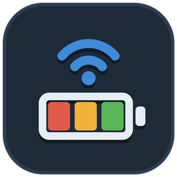

<p align="center"></p>

# Battery State

Battery levels of your wireless mouse, keyboard and headset in the Linux system tray.
A single static binary written in Go, with no vendor software, daemon or runtime needed.

Inspired by and protocol-compatible with
[Wireless Battery](https://github.com/krisgfx9/Wireless-Device-Battery-Monitor) (Windows, C++).

## Display

- **One tray icon per device**: a small pictogram (mouse, keyboard or headset) on top, the
  percentage below it and a level bar along the bottom.
- **Low battery**: the number turns red at 15% or less, and a desktop notification appears once.
- **Charging**: the bar turns blue.
- **Asleep or off**: the icon is dimmed and shows the last known value (`–` if there is none yet).
- **No access**: `?` means the device was found but can't be read yet; see [Access](#access).
- Hover for the name and details. **Click** an icon for the settings window, **right-click** for
  the menu: every device with its level, *Settings…*, *Refresh now*, *Set up access…* (only when
  needed), *Start on login* and *Quit*.

## Settings window

Click any of the icons (or start `battery-state` again, e.g. from the application menu) to open
it; click again to close it.

- **Devices shown in the tray**: untick a device to remove its icon (it also stops sending
  low-battery notifications). With every device hidden, the app icon stays so the window remains
  reachable.
- **Start on login**.
- **Check for updates** (only in the installed copy, off by default): looks for a new release on
  GitHub once a day and offers *Update to X.Y.Z*, which downloads, checks and installs it and
  restarts the tray.
- **Install** (only when not running the installed copy): installs this copy and switches the
  tray over to it.

The choices are saved in `~/.config/battery-state/settings.json`. The window is drawn by the app
itself over X11, so it needs X11 or XWayland (present on GNOME, KDE, Cinnamon and sway by
default); the tray icons work without it.

Levels are read every 60 seconds (`--interval`), and within a few seconds after a device or
receiver is plugged in.

Works with any desktop that shows StatusNotifierItem tray icons: Cinnamon, KDE Plasma, XFCE,
MATE, LXQt, Budgie, Waybar, and GNOME with the AppIndicator extension.

## Supported devices

| Vendor | Devices | How |
|---|---|---|
| **Glorious** | Model O / O- / D / D- Wireless, Model O 2 Wireless, Model D 2 PRO (receiver or cable) | Vendor feature report on the hidraw node (needs [access](#access)) |
| **Logitech / ASTRO** | A50 Gen 5 (`046D:0B1C`, tested), A50 X (`046D:0B0B`) via the USB base station | Vendor HID report, read-only battery query |
| **Logitech** | Mice and keyboards on Unifying, Bolt and Lightspeed receivers, e.g. G515 LS TKL (tested) | The kernel's `hid-logitech-hidpp` driver (`/sys/class/power_supply`), no setup needed |
| **Others** | Any device whose kernel driver reports a battery in `/sys/class/power_supply` (Bluetooth mice and keyboards, game controllers, …) | Same as above |

## Install

```bash
./install.sh            # builds and installs to ~/.local/bin, adds it to the application menu
./install.sh uninstall  # removes it again
```

Needs Go 1.27 or newer to build. A prebuilt binary works too: `battery-state --install` copies
itself to `~/.local/bin/battery-state`. No root is needed for installing.

Or click a tray icon and press **Install** in the settings window. Turn on *Start on login* there
(or in the tray menu) to have it start with your session.

## Access

Logitech receivers and the A50 base station usually work right away. The Glorious mouse's hidraw
node belongs to root, so on first start its icon shows `?`. Click **Set up access…** in the menu
(or run `battery-state --setup`) and enter your password once. It installs a udev rule that gives
the user at the seat access to the supported devices, the same way Steam's and HeadsetControl's
rules do. No group and no new login are needed.

<details>
<summary>Manual setup</summary>

```bash
battery-state --udev-rules | sudo tee /etc/udev/rules.d/60-battery-state.rules
sudo udevadm control --reload
sudo udevadm trigger --subsystem-match=hidraw --action=change
```

</details>

## Command line

```
battery-state              start the tray (default); if it already runs, open its settings window
battery-state --settings   start the tray with the settings window open
battery-state --update     install the latest release if it is newer
battery-state --list       print the devices and their levels (--json for JSON)
battery-state --dump       list all hidraw nodes, to help add a new device
battery-state --setup      install the udev rule (asks for your password)
battery-state --udev-rules print that rule
battery-state --install    install for the current user; --uninstall removes it
battery-state --interval 30s
```

## Build and test

```bash
make            # development build: target/debug/battery-state
make release    # static, stripped build: target/release/battery-state
make test       # go test ./...
make run ARGS=--list
make icon       # regenerate the logo in assets/ (needs Pillow)
```

Releases: push a tag `vX.Y.Z`; `.github/workflows/release.yml` builds a static binary and
publishes `battery-state-vX.Y.Z-x86_64-linux.tar.gz`.

## Licenses

MIT, see [LICENSE](LICENSE). Uses [godbus/dbus](https://github.com/godbus/dbus) (BSD-2-Clause)
and [golang.org/x/image](https://pkg.go.dev/golang.org/x/image) with the embedded Go Bold font
(BSD-3-Clause), and `golang.org/x/sys` (BSD-3-Clause).
